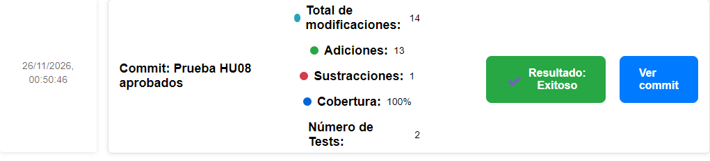
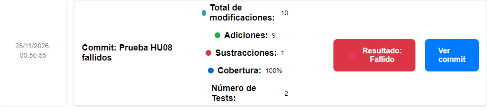
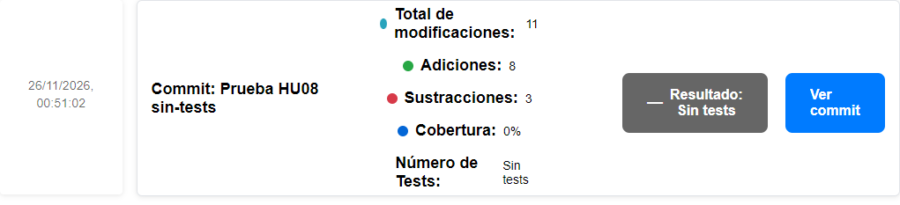
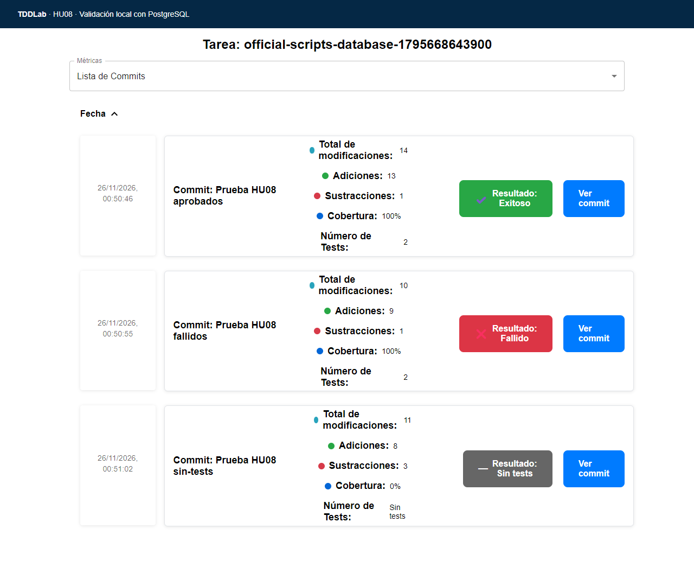

# Validación de scripts HU07 para HU08

El flujo local de los scripts oficiales pasa las pruebas con repositorio falso y PostgreSQL: ejecuta tests, conserva los JSON, envía los resultados y permite consultarlos y verlos en TDDLab. Se hicieron dos ajustes necesarios para el caso sin tests. La publicación en Trello y Notion, la confirmación del entorno compartido y la evidencia del calendario de las dos semanas siguen pendientes.

Responsable de HU08: Andrés. Apoyo: Carlos. Ejecución: 26 de noviembre de 2026, America/La_Paz. Repositorio: andresrev070303/cachuchines-TddLabbase-Project. Rama: main. Base revisada: bda830fe1432a405a62eda42871b7a6882d95363. Los commits de implementación y pruebas están en [el registro de commits](evidence/commits.json). Esta entrega queda local, sin push ni PR.

## Alcance

Se verificaron tddScript.js, commitScript.js, commit-tracker.js, send-test-results.js y el post-commit real. Las pruebas crean repositorios Git temporales y usan las dependencias instaladas del proyecto. Se cambia únicamente la prueba de muestra para producir resultados aprobados, fallidos o ausencia de tests; los generadores y el emisor son los oficiales. El envoltorio del hook respeta HUSKY=0 para evitar recursión durante el amend. No se valida aquí la instalación inicial de Husky ni las reglas de mensajes de commit.

El backend es TDDLab en el commit 4639ee4bbcc497a39616e1c24b1419cb02f075f4, ya validado en la primera parte de HU08. No se volvió a modificar su código. Este repositorio base no contiene otro backend. Se usaron Node.js v22.23.5, PostgreSQL 18.4, una base local exclusiva tddlab_hu07 y Cypress Electron 118.0.5993.159. El backend de QA se ejecutó con Node 24.22.1.

Los dos JSON originales de este repositorio se mantuvieron intactos, comprobados mediante SHA256. Los commits temporales no se enviaron a GitHub. Las identidades hu07-validation son datos de prueba. No se usó Neon ni una base compartida para esta ejecución.

## Plan y resultados

| Caso | Acción | Resultado esperado | Resultado |
|---|---|---|---|
| Aprobados | Ejecutar dos tests correctos y crear commit | 2 tests y success; ambos endpoints aceptan | Aprobado en falso y BD |
| Fallidos | Ejecutar dos tests con un fallo intencional | 2 tests y 1 fallido; el commit termina y registra failure | Aprobado en falso y BD |
| Sin tests | Eliminar la prueba de muestra en el repositorio temporal | 0 tests; respaldo neutral y envío skipped; vista Sin tests | Aprobado después de los dos ajustes |
| Repetido | Reenviar el mismo SHA después del amend | jobs devuelve duplicate; logs se aceptan; quedan 3 jobs y 1 snapshot | Aprobado en falso y BD |
| Backend apagado | Crear otro commit con destino local sin servicio | Commit con código 0; respaldos guardados y un error por endpoint | Aprobado en falso y BD |

El fallo del caso Fallidos es intencional y pertenece a la muestra temporal. No es una falla de las pruebas de regresión de este proyecto.

| Verificación | Resultado final | Evidencia |
|---|---|---|
| Pruebas HU07 del emisor y hook | 21 aprobadas y 0 fallidas | E1 |
| Jest de la aplicación base | 1 suite y 1 test aprobado | E2 |
| Integración con falso | 6 tests aprobados y 0 fallidos | E3 |
| Integración con PostgreSQL | 6 tests aprobados y 0 fallidos | E4 |
| Navegador | 2 escenarios aprobados y 0 fallidos | E5 |
| Compilación Parcel | Código de salida 0 | E6 |
| ESLint del emisor y sintaxis del script | Código de salida 0 | E6 |

Cada suite de integración cuenta cinco comprobaciones y su contenedor de Node como seis tests. No se suman las ejecuciones intencionalmente fallidas de la muestra a las pruebas aprobadas del proyecto.

La revisión general de ESLint devuelve código 1: 146 errores y 40 advertencias, de los cuales 135 errores corresponden a archivos versionados. También inspeccionó archivos generados de dist y coverage. Esto ya ocurría antes de los cambios y no se presenta como una verificación aprobada. El emisor sí pasa su revisión específica. Los detalles están en [el resumen de estilo](evidence/eslint-summary.json); no se amplió HU08 para reformatear todo el proyecto.

## Comparación de los datos

Para cada caso se ejecutó el script de npm test, se creó un commit y se dejó trabajar al hook real. Se comprobó que el SHA enviado coincide con el commit final después del amend y que ambos JSON forman parte de ese commit. Después se consultaron los endpoints, las tablas de PostgreSQL y los bloques de la vista.

Se compararon los contadores de tests, estado, cobertura, mensaje, fecha, modificaciones, adiciones, sustracciones y enlace. El contenido completo de ambos JSON se comparó con el snapshot de la base, incluidos los campos que no aparecen en la tarjeta. Reenviar el mismo commit mantuvo tres jobs y un snapshot, y no cambió los respaldos.

Hay dos conversiones previstas. El backend reemplaza HEAD por el SHA final en sha y commitId. El emisor convierte neutral a skipped para cumplir el contrato del backend; ambos representan un commit sin tests y la vista muestra Sin tests. Esta conversión ocurre solo en el JSON enviado: el respaldo local conserva neutral. El resto del contenido se conserva. Los ID internos de jobs no tienen que ser iguales entre almacenamientos.

La página de navegador reutiliza los componentes y el adaptador fetch reales de TDDLab. La prueba redirige el propietario, repositorio, rama y puerto del ejemplo de QA hacia los datos de esta ejecución; las respuestas llegan del backend y PostgreSQL reales. Solo se simula la consulta de comentarios, ajena a la migración. No se valida una sesión completa con autenticación ni un despliegue del equipo.

## Ajustes necesarios para completar la prueba

### Registro de cero tests

Antes del ajuste, ejecutar sin tests reutilizaba script/report.json de la ejecución fallida anterior. El log anotaba 2 tests y 1 fallo cuando correspondía cero. Se evita reutilizar ese archivo y se registra una ejecución vacía solo cuando Jest confirma que no encontró tests y termina correctamente. La evidencia inicial y la repetición aprobada se conservan en E3 y E7.

### Compatibilidad de neutral con el backend

El tracker conserva neutral para un commit sin tests, pero ingest-logs exige skipped. La prueba inicial recibió HTTP 400 indicando commitHistory[0].conclusion. El emisor ahora convierte ese valor al enviar ambos endpoints y conserva el respaldo original. Se añadió una prueba que verifica la conversión sin modificar la entrada. Los otros scripts y el backend no se reestructuraron.

La primera prueba de navegador comparaba el enlace antiguo de un commit que antes era HEAD con el enlace ya actualizado por el siguiente commit. Se ajustó la expectativa para usar la última versión del historial; no hizo falta modificar la vista. El resultado inicial está guardado en browser-first-run.json. Las capturas finales corresponden a la ejecución aprobada.

## Matriz de criterios

Cumplido significa verificado en el entorno local descrito. No cumplido identifica una evidencia o publicación pendiente, aunque la compatibilidad técnica se haya probado.

| ID | Criterio | Estado | Evidencia o pendiente |
|---|---|---|---|
| HU07-1 | JSON con la estructura del contrato | Cumplido | 21 tests del emisor y registro HTTP real en ambos modos |
| HU07-2 | Envío automático después de procesar los tests | Cumplido | Hook real ejecutado con los generadores reales y SHA final después del amend |
| HU07-3 | URL desde una variable de configuración | Cumplido | TDDLAB_BACKEND_URL y pruebas de envío desactivado sin variable |
| HU07-4 | Un error no interrumpe el trabajo y queda registrado | Cumplido | Commit con backend apagado termina con código 0; dos errores y respaldos guardados |
| HU07-5 | Se conservan los archivos actuales como respaldo | Cumplido | Ambos JSON incluidos en los commits temporales; archivos originales intactos |
| HU07-6 | Semana uno con falso y semana dos con base de datos | No cumplido | Ambos modos aprobados el 26 de noviembre; no se acredita aquí la cronología de dos semanas |
| HU07-7 | Cambios documentados en docs como continuación del análisis | Cumplido | Este reporte complementa los documentos HU07 existentes |
| HU08-1 | Plan con aprobados fallidos sin tests y repetido | Cumplido | Plan y casos ejecutados en este reporte |
| HU08-2 | JSON base y vista coinciden para cada caso | Cumplido | SELECT y tarjetas comparados; conversiones HEAD y neutral explicadas |
| HU08-3 | Flujo completo ejecutar enviar registrar consultar visualizar | Cumplido | Scripts oficiales y hook reales; backend real PostgreSQL y página real de TDDLab |
| HU08-4 | Archivo falso y BD con la misma forma de datos | Cumplido | Prueba previa del backend en 4639ee4b; aquí se validan los dos modos del backend |
| HU08-5 | Defectos en Trello y bloqueantes resueltos | No cumplido | Dos bloqueantes resueltos; fichas preparadas y publicación diferida por el usuario |
| HU08-6 | Criterios HU02 a HU07 con evidencia | Cumplido | HU07 en esta matriz; HU02 a HU06 en el reporte previo del backend |
| HU08-7 | Reporte en repositorio y Notion de integrantes | No cumplido | Reporte local incluido; publicación en Notion diferida por el usuario |

Los criterios HU02 a HU06 y la comparación de los tres adaptadores están en el [reporte previo de TDDLab](https://github.com/UCB-TallerDeDesarrollo/TDDLab/blob/4639ee4bbcc497a39616e1c24b1419cb02f075f4/docs/hu08/REPORTE_HU08.md). Esta segunda parte aporta la evidencia de los scripts oficiales que faltaba allí. Los documentos anteriores de HU07 se conservan como evidencia histórica y corresponden a otras revisiones del backend.

## Capturas de la ejecución final

Estas imágenes fueron obtenidas por Cypress de la página real de TDDLab y de Sumador compilado, en el entorno local de pruebas.

### Commit con tests aprobados

### Commit con tests fallidos

### Commit sin tests

### Lista completa después del reenvío

### Aplicación base compilada

## Evidencia y pendientes

- E1 [21 pruebas HU07](evidence/final-hu07-node-tests.txt).
- E2 [Resultado Jest](evidence/final-jest.json) y [salida de ejecución](evidence/final-jest.txt).
- E3 [Integración con falso](evidence/fake-flow.json) y [resultado de Node](evidence/fake-tap.txt).
- E4 [Integración con BD](evidence/database-flow.json), [resultado de Node](evidence/database-tap.txt) y [SELECT completo](evidence/database-select.json).
- E5 [Resultado Cypress](evidence/cypress-results.json) y [salida del navegador](evidence/cypress-run.txt).
- E6 [Códigos de salida finales](evidence/final-checks.json), [compilación](evidence/final-build.txt), [ESLint del emisor](evidence/final-sender-eslint.txt) y [sintaxis](evidence/final-script-syntax.txt).
- E7 [Fallo inicial sin tests](evidence/baseline-fake-flow.json), [rechazo de neutral](evidence/baseline-neutral-probe.json) y [archivos originales intactos](evidence/original-backups-check.json).
- E8 [Matriz exportada](acceptance-matrix.json), [fichas para Trello](DEFECTOS_TRELLO.md) y [reproducción](REPRODUCCION.md).

No se añadieron reintentos ni una cola automática. Si falla el envío, los respaldos y el error permanecen, y se puede reenviar manualmente mientras el commit siga siendo HEAD. La base conserva el último snapshot por rama; la política ante estados distintos que lleguen fuera de orden sigue pendiente en el backend. El calendario de las semanas y el entorno compartido requieren evidencia del equipo. La publicación en Trello y Notion se mantiene diferida por decisión del usuario.
